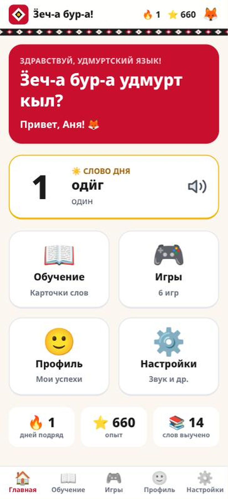
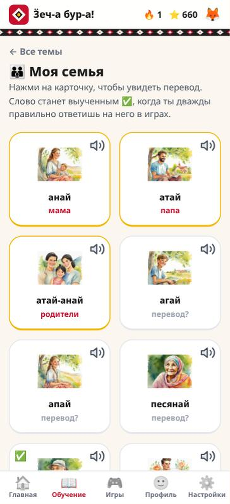
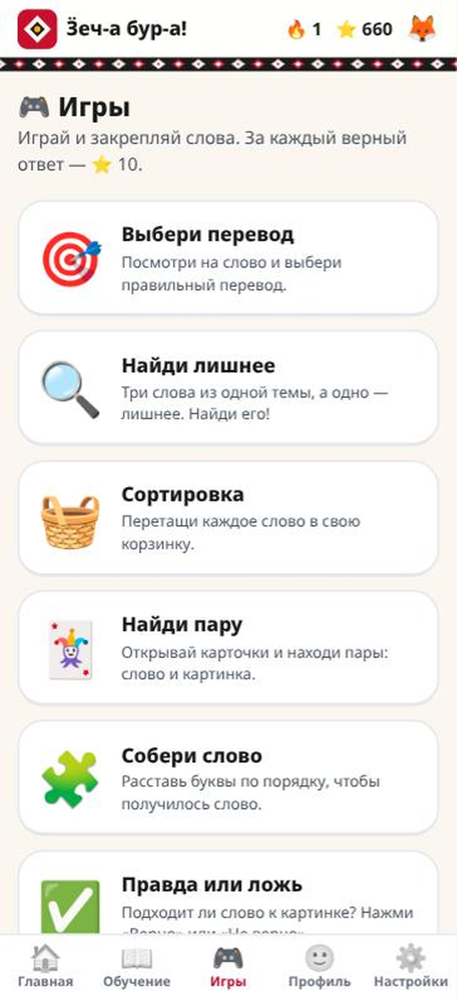
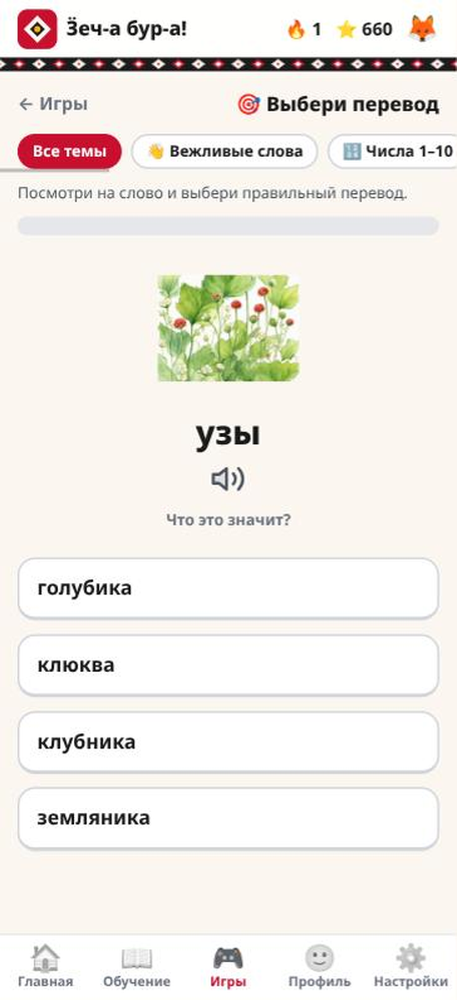
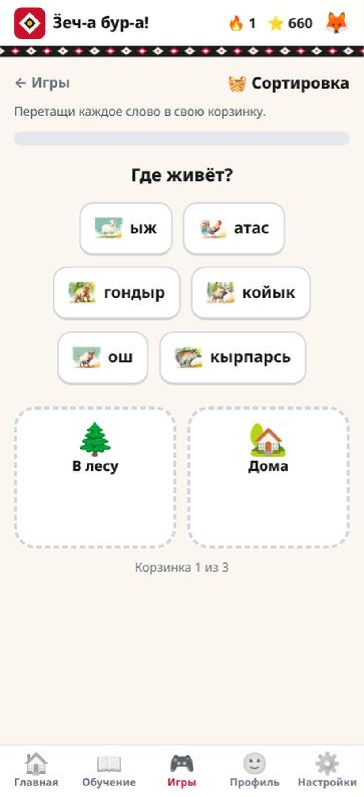
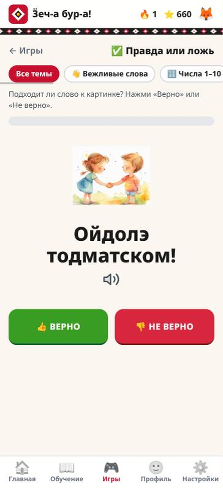
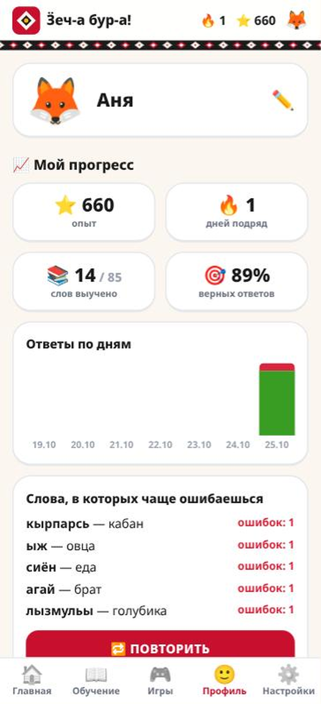
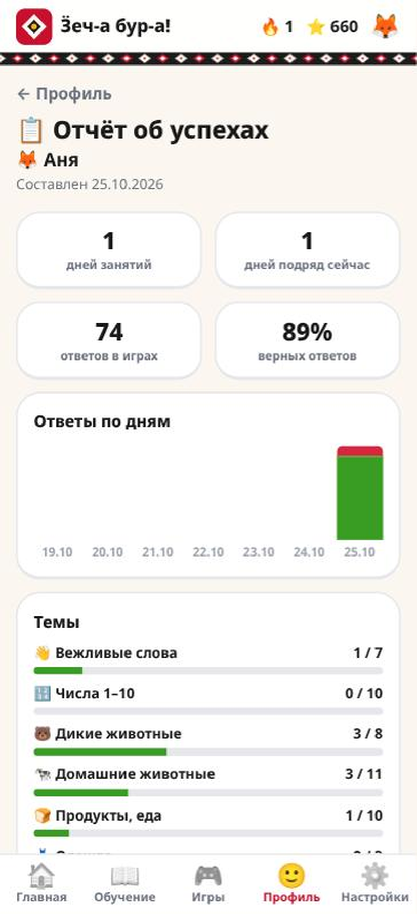
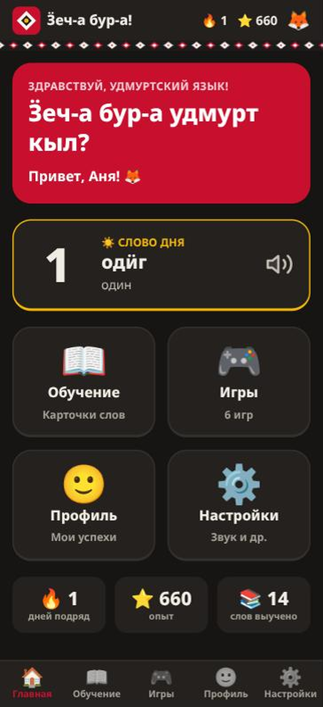

# Ӟеч-а бур-а удмурт кыл? — «Здравствуй, удмуртский язык!»

Мобильное приложение для детей 5–10 лет, которые начинают учить удмуртский язык: карточки слов
по темам и шесть игр. Работает **без интернета**: все слова и картинки ставятся вместе с APK.
Проект команды «Вотэс» для хакатона «Удмуртский ИТ-класс „Вотэс“» (направление «Мобильная разработка»).

[](https://github.com/MarshMeg/hakaton-votes-2026/actions/workflows/ci.yml)
· **[Скачать APK](https://github.com/MarshMeg/hakaton-votes-2026/releases/latest/download/votes.apk)**
· Веб-версия: https://hakaton.marshmeg.ru

## Что умеет
Главное меню — четыре раздела из ТЗ:
- **Обучение** — 11 тем из материалов кейса (вежливые слова, числа, дикие и домашние животные,
  еда, одежда, семья, овощи, цвета, ягоды, фразы). Карточка: слово по-удмуртски, картинка,
  перевод по нажатию, произношение (транскрипция или аудио, если они добавлены в админке).
- **Игры** — «Выбери перевод», «Найди лишнее», «Сортировка» (перетаскивание в корзинки),
  «Найди пару» (Memory), «Собери слово» из перемешанных букв, «Правда или ложь».
  Плюс режим **«Трудные слова»**: «Выбери перевод» только по словам, в которых ребёнок ошибался;
  слово перестаёт быть трудным после трёх верных ответов подряд (открывается и из профиля).
  За верный ответ — ⭐ 10, за дни занятий подряд — 🔥, в конце игры от 1 до 3 звёзд.
- **Профиль** — имя и зверёк-аватар (без имени показывается имя для входа), статистика (сколько
  слов выучено, какие слова чаще вызывают ошибки — пока слово в трудных, выученным оно не считается,
  ответы по дням), **отчёт для родителя или учителя** (можно распечатать), факты об
  удмуртском языке, аккаунт и выход из него.
- **Настройки** — звук, уведомления («Слово дня» раз в день), геолокация (расстояние до Ижевска).
- **Слово дня** на главной.

При первом запуске нужно зарегистрироваться (имя ребёнка, зверёк, имя для входа и пароль) или войти.
Первый вход — только с интернетом, дальше приложение работает и без сети. Прогресс хранится в
аккаунте, поэтому его можно продолжить на другом телефоне.

## Скриншоты
Веб-версия на ширине телефона (412 px). Цвета и шрифты — по брендбуку, тема выбирается в настройках
(«Как в телефоне», «Светлая», «Тёмная»).

| | | |
|:-:|:-:|:-:|
|  |  |  |
| Главная | Карточки темы | Список игр |
|  |  |  |
| Выбери перевод | Сортировка | Правда или ложь |
|  |  |  |
| Профиль и статистика | Отчёт для родителя | Тёмная тема |

## Как устроен офлайн
```
Android (Flutter)                                    Сервер (Django)
┌──────────────────────────────────────────┐         ┌──────────────────────────────┐
│ WebView  https://hakaton.marshmeg.ru/…   │         │ страницы, /content.json      │
│   │ каждый GET перехватывается           │         │ build_bundle → /bundle/      │
│   ▼                                      │ обнов-  │   manifest.json + blobs/<sha>│
│ офлайн-снимок: assets APK │ скачанный    │◀─ления─│                              │
│                                          │         │ /api/signup, login, save     │
│ игры и прогресс — JS в WebView,          │─сохр.─▶│ (одно сохранение на аккаунт) │
│ localStorage + копия в файле приложения  │         │ /admin — словарь, картинки   │
└──────────────────────────────────────────┘         └──────────────────────────────┘
```
- Все экраны одинаковы для любого игрока: имя, опыт и статистику подставляет JS. Поэтому
  `manage.py build_bundle` может «сфотографировать» сайт в **офлайн-снимок** (страницы, статика,
  словарь, медиа) — сейчас это около 3,4 МБ (из них ~2,9 МБ — картинки к словам).
- Снимок кладётся в APK. Приложение отвечает WebView из снимка, адрес при этом остаётся настоящим,
  и всё работает сразу после установки, даже в авиарежиме.
- При каждом запуске, если есть сеть, приложение сначала скачивает новую версию снимка (только
  изменившиеся файлы, каждый проверяется по sha256) и сразу её включает. Без сети этот шаг
  пропускается. **Прогресс хранится отдельно и при обновлении не теряется.**
- Прогресс — одно «сохранение» на аккаунт: профиль, счётчики по словам, дням и играм, настройки
  (звук, уведомления, геолокация), плюс время изменения. Оно лежит на телефоне (и в копии в файле приложения на случай очистки данных WebView)
  и обновляется после каждого законченного действия: игра пройдена, карточки темы просмотрены,
  профиль изменён, переключена настройка. Сразу после этого сохранение уходит на сервер; без сети — при следующем запуске.
- При запуске телефон сравнивает своё сохранение с серверным: более новое заменяет старое целиком.
  Схема: [docs/client-server.mmd](docs/client-server.mmd) (открывается в https://mermaid.live).

Подробнее: [docs/ARCHITECTURE.md](docs/ARCHITECTURE.md).

## Стек
| Слой | Технологии |
|---|---|
| Backend | Python 3.12 (uv), Django 5.2, gunicorn, whitenoise |
| Frontend | Django Templates, Alpine.js, Tailwind CSS (брендбук в `backend/tailwind.config.js`) |
| Данные | PostgreSQL 16, MinIO (S3) для аудио и картинок |
| Мобильное приложение | Flutter: `flutter_inappwebview` (перехват запросов), уведомления, геолокация |
| Инфраструктура | mise, Docker Compose, GitHub Actions (линтер, проверка миграций, сборка APK) |

## Быстрый запуск (Docker)
Пошаговая инструкция, в том числе для телефона и без Docker, — [RUN.md](RUN.md).
```bash
cp .env.example .env          # необязательно
docker compose up --build
```

| Адрес | Что там |
|---|---|
| http://localhost:8000 | приложение (откройте в мобильном режиме браузера) |
| http://localhost:8000/admin | словарь, картинки, аудио (`admin` / `admin12345`) |
| http://localhost:9001 | консоль MinIO (`minioadmin` / `minioadmin`) |

При старте контейнер применяет миграции, загружает словарь из `backend/seeds/vocab.yaml`,
собирает офлайн-снимок и создаёт администратора.

## Сервер и деплой
Сервер — Debian с Docker, проект лежит в `/opt/votes`. Там тот же `docker-compose.yml` плюс
надстройка [docker-compose.prod.yml](docker-compose.prod.yml): наружу смотрит только Caddy
(порты 80/443, HTTPS-сертификат получает сам), он же раздаёт медиа из MinIO по пути `/votes-media/`.

Деплой автоматический: после push в `main` и зелёных проверок ([ci.yml](.github/workflows/ci.yml))
задача `build` собирает образ web в GitHub Actions и публикует его в GHCR, а `deploy` копирует
compose-файлы на сервер по SSH и запускает [deploy/deploy.sh](deploy/deploy.sh): тот скачивает образ
и перезапускает web (миграции, словарь и офлайн-снимок — в `backend/entrypoint.sh`). Если после этого
сайт не отвечает, сервер откатывается на предыдущий образ, а задача падает. Настройки в GitHub: секрет
`DEPLOY_SSH_KEY`, переменные `DEPLOY_HOST`, `DEPLOY_USER`, `DEPLOY_KNOWN_HOSTS`, `DEPLOY_URL`.

Секреты и адрес сайта хранятся в `/opt/votes/.env` на сервере (в git его нет, деплой его не трогает):
ключ подписи токенов входа — `DJANGO_SECRET_KEY` (обязателен: без него `docker-compose.prod.yml`
не запустится), пароль администратора — `DJANGO_SUPERUSER_PASSWORD`, адрес — `SITE_ADDRESS`, ссылки на медиа —
`S3_PUBLIC_DOMAIN` и `S3_PUBLIC_PROTOCOL`. После правки `.env` — перезапуск той же командой `up -d`.

Новый сервер (Debian 13, от 1 ГБ памяти) готовится один раз под root:
1. swap 2 ГБ (`/swapfile` в `/etc/fstab`): PostgreSQL, MinIO и gunicorn в 1 ГБ не помещаются;
2. Docker Engine и `docker-compose-plugin` из репозитория download.docker.com, плюс `rsync`;
3. пользователь `deploy` в группе `docker`, в его `~/.ssh/authorized_keys` — публичный ключ от
   `DEPLOY_SSH_KEY`; каталог `/opt/votes` принадлежит `deploy`;
4. `/opt/votes/.env` по образцу [.env.example](.env.example) со случайными паролями и
   `SITE_ADDRESS`/`S3_PUBLIC_DOMAIN` под домен;
5. в GitHub — `DEPLOY_HOST`, `DEPLOY_KNOWN_HOSTS` (`ssh-keyscan -t ed25519 <ip>`) и `DEPLOY_SSH_KEY`.

Дальше домен направляется на IP сервера и перезапускается задача `deploy` последнего прогона CI на
`main`: она скопирует файлы, поднимет контейнеры, а Caddy сам получит сертификат.

## Запуск без Docker
Инструменты ставятся через [mise](https://mise.jdx.dev), подробно — [docs/local-setup.md](docs/local-setup.md).
```bash
cd backend
mise trust && mise install   # uv + Tailwind CLI
mise run setup               # uv sync (Python 3.12, зависимости), миграции, словарь
mise run dev                 # http://localhost:8000
```

## Android-приложение
**Скачать APK:** https://github.com/MarshMeg/hakaton-votes-2026/releases/latest/download/votes.apk
(Android 8.0 и выше).

CI собирает APK только при изменениях в `mobile/` (`flutter analyze`,
`flutter build apk`). Офлайн-снимка в этом APK нет: приложение скачивает его с сервера при первом
запуске. Сборка из `main` публикуется в [Releases](https://github.com/MarshMeg/hakaton-votes-2026/releases).

Локально (Android SDK — из Android Studio):
```bash
cd backend && mise run bundle   # снимок → mobile/assets/bundle
cd ../mobile
mise run setup                  # flutter create + pub get
mise run dev                    # эмулятор против http://10.0.2.2:8000
```

## Линтер
```bash
cd backend && mise run lint
cd mobile && mise run check
```

## Контент
Словарь описан в `backend/seeds/vocab.yaml` (формат — в начале файла) и загружается командой
`python manage.py seed`. Уже загруженные слова сохраняют id, поэтому прогресс детей не теряется;
`seed --update` перезаписывает слова значениями из файла. Картинки, аудио и транскрипцию удобнее
добавлять в админке. После правок контента выполните `manage.py build_bundle` (на сервере он
выполняется при каждом старте), и телефоны получат обновление.

> ⚠️ Слова взяты из «Материалов к кейсу». Перед сдачей их нужно сверить с носителем языка.
> Спорные места помечены в поле `needs_check`. Факты о языке тоже нужно проверить.

## Документация
| Документ | О чём |
|---|---|
| [docs/ARCHITECTURE.md](docs/ARCHITECTURE.md) | общая схема, офлайн-снимок, сохранение и синхронизация, деплой |
| [docs/BACKEND.md](docs/BACKEND.md) | модели, страницы и API, management-команды, запуск |
| [docs/FRONTEND.md](docs/FRONTEND.md) | `app.js` и `games.js`, шаблоны, особенности Alpine.js 3 |
| [docs/MOBILE.md](docs/MOBILE.md) | Flutter-обёртка, обновление снимка, мост, разрешения, сборка APK |
| [docs/development.md](docs/development.md) | команды, CI/CD и соглашения для разработчика |
| [RUN.md](RUN.md) | как запустить проект локально: Docker, телефон, без Docker |
| [docs/local-setup.md](docs/local-setup.md) | настройка окружения с нуля |

## Структура
```
backend/            Django-проект
  config/           настройки, URL
  vocab/            словарь: темы, слова, наборы для сортировки, факты; seed; /content.json
  play/             экраны, API аккаунта и сохранения, build_bundle
  accounts/         профиль аккаунта с сохранением прогресса
  templates/        HTML-шаблоны (Alpine.js); игры — templates/play/games/
  static/js/        app.js — вход, сохранение, синхронизация, статистика; games.js — шесть игр и «Трудные слова»
  seeds/            vocab.yaml и медиа к нему
mobile/             Flutter: WebView + офлайн-снимок (lib/bundle.dart) + мост (lib/bridge.dart)
docs/               архитектура, заметки для разработчика, настройка окружения
```

## Команда
| Участник | Роль |
|---|---|
| Дмитрий Чувашев | проектный менеджер / разработчик |
| Зылева Дарья | дизайнер |
| Касимов Максим | ручной тестировщик |
| Вятчанин Руслан | ручной тестировщик |
